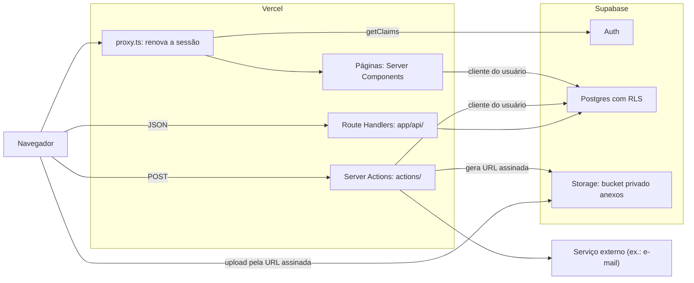

# Arquitetura: <Nome do App>

> Modelo de `docs/arquitetura.md` para um aplicativo construído sob o
> **[Development Pattern for Web Apps](https://github.com/adrianorafael/development-pattern-for-web-apps)**.
> Regra **R13**. Este arquivo muda no mesmo commit que acrescenta uma parte, um serviço
> externo ou um fluxo entre partes.
>
> **Quando NÃO criar:** script avulso, ou app de uma tela sem banco, em que o README já é o
> mapa inteiro. A partir de login e banco (N2), ele existe.
>
> Uma página. Se passar de duas, o detalhe é de outro documento: o banco em
> [`banco-de-dados.md`](banco-de-dados.md), as rotas em [`api.md`](api.md), a segurança em
> [`seguranca.md`](seguranca.md), o porquê de cada escolha em [`decisoes/`](decisoes/).

**Conferido contra o código em:** `<AAAA-MM-DD>` · **Versão:** `<x.y.z>`

---

## 1. Visão geral

<Três frases, para quem nunca viu o projeto: o que o sistema faz, para quem, e as partes
principais. Exemplo:>

O **<Nome do App>** registra e acompanha chamados de suporte de uma equipe pequena. Cada
pessoa abre e acompanha os próprios chamados, com anexos; o administrador vê todos. É um app
Next.js publicado na Vercel, com banco, login e arquivos no Supabase.

## 2. Diagrama

O navegador também fala direto com o Supabase: envia o arquivo pela URL assinada que a
action gerou, e qualquer pessoa pode chamar a API REST com a publishable key, que está no
JavaScript da página. É por isso que a RLS, e não o app, é quem segura o banco.

## 3. Onde cada parte vive no código

| Parte | Pasta ou arquivo | Responsabilidade |
| --- | --- | --- |
| Rotas e páginas | `app/` | A pasta é a URL (R15); Server Components por padrão |
| Server Actions | `actions/` | Toda escrita da interface: sessão, validação, operação, erro genérico |
| Route Handlers | `app/api/**/route.ts` | Entrada por JSON e webhooks ([`api.md`](api.md)) |
| Interceptação | `proxy.ts` | Renova a sessão; redireciona deslogado. Não autoriza |
| Acesso ao Supabase | `lib/supabase/server.ts`, `lib/supabase/browser.ts` | Cliente do usuário (respeita a RLS) e cliente admin (só servidor) |
| SQL direto | `lib/db.ts` | Consultas que não passam pela RLS: o dono vai no `WHERE` |
| Sessão e papel | `lib/sessao.ts` | `exigirSessao()`, `exigirPapel()` |
| Ambiente | `lib/env.ts` | Valida toda variável na carga (R9) |
| Componentes | `components/ui/`, `components/<domínio>/` | Primitivos sem regra; componentes do domínio |
| Banco | `supabase/migrations/` | Schema, políticas e bucket, em ordem ([`banco-de-dados.md`](banco-de-dados.md)) |

## 4. O caminho de uma requisição

<O fluxo mais importante do app, passo a passo. Exemplo: abrir um chamado.>

1. A pessoa envia o formulário de `/abrir-chamado`; o navegador faz POST para a action
   `criarChamado`.
2. A action chama `exigirSessao()`: sem sessão, redireciona para `/entrar`.
3. O Zod valida `titulo` e `descricao`; erro volta para a tela, campo a campo.
4. O insert vai pelo cliente do usuário; a política `chamados_insert_dono` confere, no
   banco, que o dono é quem está logado.
5. `revalidatePath('/chamados')` e a lista mostra o chamado novo.

## 5. Ambientes

| Ambiente | Onde roda | Banco |
| --- | --- | --- |
| Development | `npm run dev`, na máquina | Supabase local (`npx supabase start`) |
| Preview | Deploy por ramo na Vercel | Branch do Supabase, ou projeto separado; nunca o de produção |
| Production | `https://seu-dominio.com.br` | Projeto Supabase de produção |

## 6. Decisões que moldaram esta arquitetura

| Decisão | Arquivo |
| --- | --- |
| `<RLS e conferência no servidor, as duas>` | [`decisoes/0001-<slug>.md`](decisoes/) |
| `<...>` | `<...>` |
