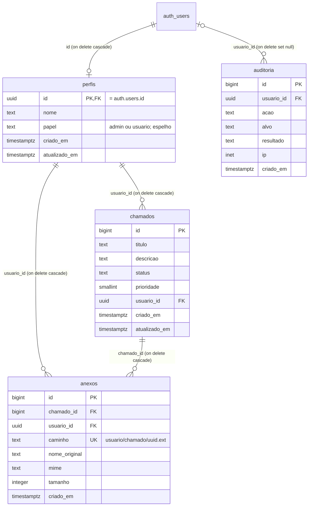

# Banco de dados: <Nome do App>

> Modelo de `docs/banco-de-dados.md` para um aplicativo construído sob o
> **[Development Pattern for Web Apps](https://github.com/adrianorafael/development-pattern-for-web-apps)**.
> Regras **R7**, **R10** e **R13**. Este arquivo muda no mesmo commit que a migração.
>
> **Quando NÃO criar:** app sem banco (vitrine sem login, script avulso). Com Supabase, ele
> existe: mesmo um app de duas tabelas tem uma matriz de acesso que alguém vai precisar ler.
>
> Este modelo já vem preenchido com o exemplo de chamados de `schema.sql.template` e
> `politicas-rls.sql.template`. Ao copiar, troque pelo **seu** schema: um documento que
> descreve tabela que não existe é pior que nenhum.

**Banco:** Supabase (Postgres), projeto `<nome-do-projeto-supabase>` · **Última migração:**
`<timestamp>_<nome>.sql` · **Conferido contra o SQL em:** `<AAAA-MM-DD>`

---

## 1. Tabelas

Todas em `public`, todas com **RLS ligada** (P13). O usuário é `auth.users`, do Supabase
Auth: o app não tem tabela de senha.

| Tabela | Guarda | Dono da linha | Observação |
| --- | --- | --- | --- |
| `perfis` | O que o app sabe de cada usuário: `nome`, `papel` (espelho) | `id` = `auth.users.id` | Criada pelo gatilho `trg_auth_users_criar_perfil` no cadastro. `papel` é só espelho de `app_metadata.papel`: a autorização lê o JWT, nunca esta coluna |
| `chamados` | `titulo`, `descricao`, `status` (`aberto`, `andamento`, `fechado`), `prioridade` (1 a 5) | `usuario_id`, com `default auth.uid()` | O navegador não manda o dono; a política de `insert` confere |
| `anexos` | Metadados do arquivo: `caminho`, `nome_original`, `mime`, `tamanho` | `usuario_id` | O arquivo em si fica no bucket `anexos` (§4) |
| `auditoria` | `acao`, `alvo`, `resultado`, `ip`, `usuario_id` | (nenhum) | Escrita só pelo servidor e por `fechar_chamado()`; lida só por admin |
| `eventos_limite` | `chave`, `criado_em`: contador do rate limit | (nenhum) | RLS ligada e **nenhuma** política, de propósito: só a conexão direta do servidor a alcança |
| `configuracoes` | Pares `chave` / `valor` do app (`itens_por_pagina`, `manutencao`) | (nenhum) | Logado lê; só o servidor escreve |

Datas em `timestamptz`; `atualizado_em` mantido pelo gatilho `definir_atualizado_em()` em
`perfis`, `chamados` e `configuracoes`.

## 2. Relacionamentos

`auth_users` no diagrama é a tabela `auth.users` do Supabase Auth. `eventos_limite` e
`configuracoes` não se ligam a nenhuma outra.

**A cascata é a exclusão de conta da LGPD:** apagar o usuário no Auth
(`auth.admin.deleteUser`) apaga o perfil e, por ele, os chamados e os anexos (as linhas).
Os **objetos** do Storage não somem com as linhas: a exclusão de conta apaga a pasta do
usuário no bucket antes (linha-de-base-de-seguranca.md §10).

## 3. Quem lê e quem altera cada dado

Espelho das políticas e dos grants de `<timestamp>_politicas_rls.sql`. "Dono" é o
`authenticated` cujo `auth.uid()` bate com a coluna de dono; "outro" é qualquer outro
`authenticated`; admin é o `authenticated` com `app_metadata.papel = 'admin'`.

| Tabela | `anon` | Dono | Outro | Admin | `service_role` e conexão direta |
| --- | --- | --- | --- | --- | --- |
| `perfis` | nada | lê o próprio; altera só a coluna `nome` | nada | lê todos | tudo |
| `chamados` | nada | lê, cria, altera e apaga os seus; não troca o dono (`with check`) | nada | lê todos; alterar o alheio passa pelo servidor, com auditoria | tudo |
| `anexos` | nada | lê, registra e apaga os seus; só registra em chamado próprio e com caminho na própria pasta; não altera | nada | só os próprios (não há política de admin) | tudo |
| `auditoria` | nada | nada | nada | lê | tudo; `fechar_chamado()` também escreve |
| `eventos_limite` | nada | nada | nada | nada | tudo (`lib/limite.ts`, pela conexão direta) |
| `configuracoes` | nada | lê | lê | lê | tudo |

> ⚠️ `service_role` (a `SUPABASE_SECRET_KEY`) tem `BYPASSRLS`, e a conexão direta por
> `POSTGRES_URL` também não passa pela RLS do usuário. Nesses dois caminhos a autorização
> está no código, com o dono no `WHERE` ou no `.eq()`, nunca só na política.

Como provar: CT-SEC-031 (sem login, só com a publishable key, cada tabela devolve nenhuma
linha) e CT-SEC-032 (com o token de A, ler e alterar a linha de B não afeta nada), no
roteiro de QA.

### Funções

| Função | Chamada por | Roda como | Quem executa | O que confere |
| --- | --- | --- | --- | --- |
| `buscar_chamados(termo)` | `supabase.rpc('buscar_chamados', …)` | `security invoker`: quem chama, com a RLS de `chamados` | `authenticated` | O termo é parâmetro; `\`, `%` e `_` viram literais |
| `fechar_chamado(p_chamado_id)` | `supabase.rpc('fechar_chamado', …)` | `security definer`, `search_path = ''` | `authenticated` | O dono, com `auth.uid()`, dentro da função; o mesmo erro para "não existe" e "é de outro" |
| `criar_perfil_do_usuario()` | Gatilho em `auth.users` | `security definer`, `search_path = ''` | ninguém pela API (execute revogado) | Papel só de `raw_app_meta_data`, nunca de `raw_user_meta_data` |
| `definir_atualizado_em()` | Gatilhos `before update` | quem altera | gatilho | (nenhuma) |

Tabela ou função criada depois de `politicas_rls` nasce sem acesso para `anon` e
`authenticated` (`alter default privileges`): a migração que a cria concede o que precisa.

## 4. Storage

| Bucket | Público | Limite | Tipos aceitos | Caminho | Políticas em `storage.objects` |
| --- | --- | --- | --- | --- | --- |
| `anexos` | **não** | 5 MB (`5242880` bytes) | `image/png`, `image/jpeg`, `application/pdf` | `<usuario_id>/<chamado_id>/<uuid>.<ext>` | Dono lê, envia, sobrescreve e apaga só na própria pasta: `(storage.foldername(name))[1] = auth.jwt() ->> 'sub'`. Admin não tem política |

Arquivo é entregue por `createSignedUrl` de vida curta, depois de conferir o dono no
servidor; nunca por `getPublicUrl`.

## 5. Migrações

Em `supabase/migrations/`, aplicadas em ordem pelo Supabase CLI e registradas em
`supabase_migrations.schema_migrations`. Cada arquivo abre com um comentário dizendo o que
muda e se é aditivo ou destrutivo. Destrutiva só num release posterior ao que parou de usar
o objeto (R10).

| Arquivo | O que muda | Tipo |
| --- | --- | --- |
| `<timestamp>_schema_inicial.sql` | Cria `configuracoes`, `perfis` (e o gatilho em `auth.users`), `auditoria`, `chamados`, `anexos`, `eventos_limite`, as funções `buscar_chamados` e `fechar_chamado`, e os valores iniciais de `configuracoes` | aditiva |
| `<timestamp>_politicas_rls.sql` | Grants explícitos, políticas por dono e de admin, bucket `anexos` e políticas do Storage | aditiva |
| `<timestamp>_<nome>.sql` | `<o que muda, em uma linha>` | `<aditiva / destrutiva>` |

## 6. Backup

`<plano Pro: diário, 7 dias, no painel em Database > Backups / plano Free: sem backup
automático; dump com npx supabase db dump, guardado em <onde, fora do repositório>>`.
Última restauração ensaiada: `<AAAA-MM-DD>`, em `<tempo>` (CT-MIG-011).
